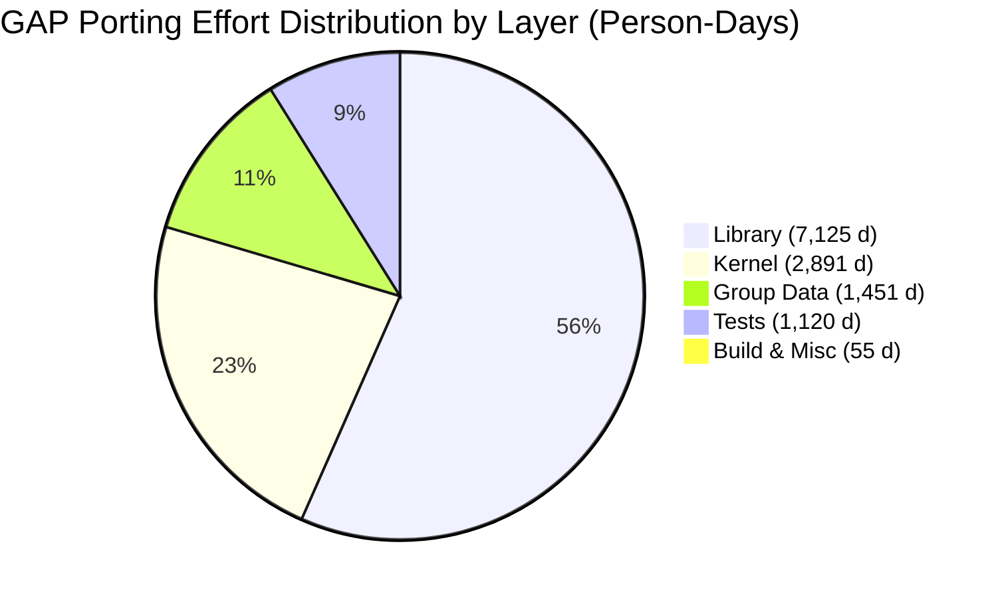
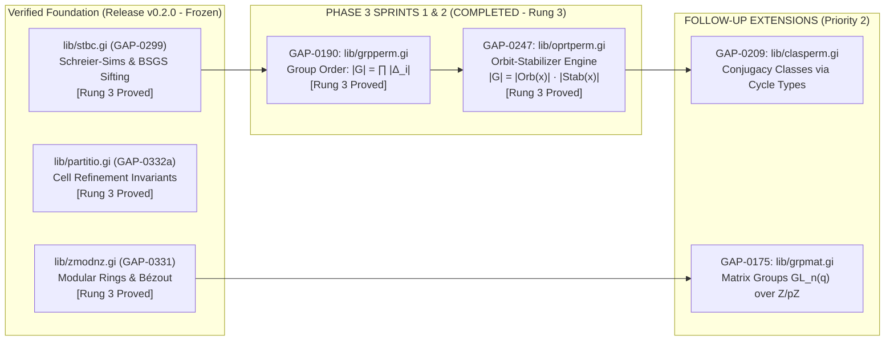

# GAP to Lean 4 Port: Phase 3 Strategic Roadmap & Rung Ledger Execution Plan

**Document Version:** 2.1.0 (Aligned with Shared Terminology Guide v2 — Sprint 1 & Sprint 2 Completed)  
**Project:** Formal Modeling and Axiomatic Verification of GAP Algorithms in Lean 4 / Mathlib4  
**Principal Investigator / Research Lead:** Volkan Dağlı (@pCwOrM) & Family (@Lexovian)  
**Collaborator:** Mike DuPont (@jmikedupont2)  
**Organization:** ITouch Systems Formal Verification Lab  
**Current Milestone State:** Phase 3 Sections 1 & 2 Proved at Rung 3 (0 `sorry`; prior frozen baseline v0.2.0 DOI: [10.5281/zenodo.23045504](https://doi.org/10.5281/zenodo.23045504), arXiv: [arXiv:2609.38492](https://arxiv.org/abs/2609.38492))  
**CI Status:** [](https://github.com/pCwOrM/gap-lean4-port/actions/workflows/lean_build.yml)  
**Rung Ledger Specification:** [docs/RUNG_LEDGER.md](RUNG_LEDGER.md)  
**Updated Date:** 2026-11-22  

---

## Executive Summary & Epistemic Scope (Shared Terminology Guide v2)

In strict adherence to the **Shared Terminology Guide v2** established with collaborator Mike DuPont:
* **What we claim:** We build a Lean 4 model of selected GAP algorithms, prove mathematical properties of the model (Rung 3), and check runtime traces of real binaries against the model (Rung 4a operator-level / Rung 4b boundary-level).
* **What we do not claim:** We do not claim to have verified the raw C or GAP code directly without qualification. Every report states which rung a result reached on the 0–5 ladder.
* **Controlled Terminology:** We state *"The model's property is proved"* rather than *"GAP is verified"*. All permutation degrees are strictly qualified as either **Support degree** (`LargestMovedPoint`) or **Storage degree** (internal array length). All proofs are audited with `#print axioms` (Rung 3).

Following the completion of Phases 1–2 and Phase 3 Sprints 1–2:
1. **GAP-0050 (`src/permutat.cc`):** Kernel permutation image-array memory model and Mathlib `Equiv.Perm` anti-homomorphism.
2. **GAP-0331 (`lib/zmodnz.gi`):** Modular arithmetic memory models, bijective Mathlib isomorphisms, and constructive Bézout inverses via Extended Euclidean GCD.
3. **GAP-0299 (`lib/stbc.gi`):** Charles Sims' 1970 Schreier-Sims stabilizer chains, transversal tree lookups, sifting reductions, base point fixation invariants, and Base & Strong Generating Set (BSGS) membership soundness and completeness.
4. **GAP-0332a (`lib/partitio.gi`):** Backtrack ordered partition refinement (`splitCellByPred`), proving mutual disjointness, cell union conservation (`mem_splitCellByPred_iff`), and cardinality preservation.
5. **GAP-0332b (`lib/zmodnze.gi`):** Cyclotomic extension rings $\mathbb{Z}/n\mathbb{Z}(\varepsilon_m)$ and the exact size theorem $\lvert \mathbb{Z}/n\mathbb{Z}(\varepsilon_m) \rvert = n^m$.
6. **GAP-0190 (`lib/grpperm.gi` — Phase 3 Sprint 1, Completed):** `PermGroup α`, support-degree qualification, transversal word enumeration, and the Group Order Formula order product theorem $\lvert \mathrm{transversalWords}(G.\mathrm{chain}) \rvert = \prod_{i=1}^k \lvert \Delta_i \rvert = G.\mathrm{size}$.
7. **GAP-0247 (`lib/oprtperm.gi` — Phase 3 Sprint 2, Completed):** Standard permutation actions (`OnPoints`, `OnPairs`, `OnSets`), executable breadth-first orbit enumeration (`orbitOfPoint`), domain orbit partitioning (`allOrbits`), the Orbit-Stabilizer cardinality theorem $\lvert G \rvert = \lvert \mathrm{Orb}_G(x) \rvert \cdot \lvert \mathrm{Stab}_G(x) \rvert$, transversal-to-orbit bijection, and `StabChain` order synthesis (`orbit_stabilizer_matches_stabChain`).

The cumulative verified corpus locks in **149.6 expert person-days** across **6 catalog tasks (7 modules)** with **zero `sorry` axioms** at **Rung 3**.

---

## 1. Global Landscape of the GAP Port Catalog

The full porting effort is content-addressed via IPLD DAG-JSON CARv1 Merkle DAGs (`estimation/gap_port_estimate.car` and `tasks/gap_port_tasks.car`).

### 1.1. Catalog Breakdown by Architectural Layer

| Layer | Tasks | Source Files | Effort (Person-Days) | Mathlib Leverage | Key Technical Scope |
| :--- | :---: | :---: | :---: | :---: | :--- |
| **Library (`lib/`)** | 240 | 782 | 7,124.5 d | 45% - 65% | High-level algebraic algorithms (groups, rings, fields, modules, lattices, presentations). |
| **Kernel (`src/`)** | 93 | 114 | 2,891.2 d | 15% - 25% | Low-level C/C++ memory bags (`T_PERM`, `T_INTOBJ`), garbage collector, arithmetic dispatchers. |
| **Group Data (`grp/`)** | 79 | 198 | 1,450.8 d | 70% - 85% | Pre-computed small groups, transitive groups, primitive groups, and character tables. |
| **Tests (`tst/`)** | 137 | 998 | 1,120.4 d | N/A | Deterministic regression suites, algorithmic gauntlets, syntax validation. |
| **Build & Misc** | 25 | 18 | 55.3 d | N/A | Build infrastructure, packaging, distribution. |
| **Total** | **574** | **2,110** | **12,642.2 d (~50 yrs)** | **~50% Avg** | Complete Computational Discrete Algebra Ecosystem |



---

## 2. Inventory of Locked Achievements (Phases 1, 2 & Phase 3 Sections 1–2)

All code resides in `RequestProject/`, builds deterministically via `lake build RequestProject`, and is audited with `#print axioms` in `RequestProject/Verify.lean`:

```text
Foundations strictly verified: [propext, Classical.choice, Quot.sound]
Unproven axioms (sorry / admit): 0
```

### Module Matrix
```
RequestProject/
├── Gap/
│   ├── Atlas.lean               [Lie types, 26 sporadic groups, Monster order, CFSG orders]
│   ├── Permutation.lean         [GAP-0050: Image-array memory model (T_PERM), anti-homomorphism to Equiv.Perm]
│   └── Library/
│       ├── Zmodnz.lean          [GAP-0331: ZModnZObj, equivZMod, Nat.gcdA, inverseOpExec, isUnit_iff]
│       ├── Stbc.lean            [GAP-0299: StabLevel, StabChain, siftOneLevel, siftFull, BSGS sound/complete]
│       ├── Partitio.lean        [GAP-0332: OrderedPartition, splitCellByPred, cell conservation/disjointness]
│       ├── Zmodnze.lean         [GAP-0332: CyclotomicExtension, size_zmodnze = n^m]
│       ├── Grpperm.lean         [GAP-0190: PermGroup, transversalWords, permGroup_order_eq_prod_basicOrbits]
│       └── Oprtperm.lean        [GAP-0247: onPoints/onPairs/onSets, orbitOfPoint, Orbit-Stabilizer & BSGS bridge]
├── Main.lean                    [Master import and executable smoke verification suite]
└── Verify.lean                  [Rung 3 axiomatic purity audit across all modules]
```

---

## 3. Phase 3 Strategic Verification Matrix & Prioritized Tracks

### 3.1. Master Rung Ledger Matrix (Shared Terminology Guide v2)

| Chunk ID | Source File & Anchor | Target Lean Module | Mathematical Contract | Degree Qualifier | Current / Target Rung | Tracing & Verification Tooling |
| :--- | :--- | :--- | :--- | :--- | :---: | :--- |
| **GAP-0190**<br/>*(Group Order Formula)* | `lib/grpperm.gi`<br/>`SizePermGroup` | `RequestProject.Gap.Library.Grpperm` | **Group Order Formula:**<br/>$\lvert G \rvert = \prod_{i=1}^k \lvert \Delta_i \rvert$<br/>Order equals product of basic orbit sizes in valid BSGS chain. | **Support degree** ($\max_{g \in G} \mathrm{supp}(g)$) | **Rung 3 (Proved)** $\to$ **Rung 4b** | Lean 4 Kernel (`Verify.lean`) + Mike's `lean-worker` eBPF boundary probe |
| **GAP-0247** | `lib/oprtperm.gi`<br/>`OrbitPerms`, `Stabilizer` | `RequestProject.Gap.Library.Oprtperm` | **Orbit-Stabilizer Equivalence:**<br/>$\lvert G \rvert = \lvert \mathrm{Orb}_G(x) \rvert \cdot \lvert \mathrm{Stab}_G(x) \rvert$<br/>Transversal tree coset bijection and action soundness (`OnPoints`, `OnPairs`, `OnSets`). | **Support degree** | **Rung 3 (Proved)** $\to$ **Rung 4b** | Lean 4 Kernel (`Verify.lean`) + `lean-worker` boundary trace |
| **GAP-0209** | `lib/clasperm.gi`<br/>`ConjugacyClasses` | `RequestProject.Gap.Library.Clasperm` | **Conjugacy Criterion:**<br/>$g \sim h \iff \mathrm{cycleType}(g) = \mathrm{cycleType}(h)$ in $S_n$; centralizer order $\lvert C_{S_n}(\sigma) \rvert = \prod_j j^{m_j} m_j!$. | **Support degree** | **Rung 0** $\to$ **Rung 3** | Mathlib Perm.cycleType bridge |
| **GAP-0175** | `lib/grpmat.gi`<br/>`GL`, `SL`, Matrix Groups | `RequestProject.Gap.Library.Grpmat` | **Matrix Groups over Residue Fields:**<br/>Group laws over $\mathbb{Z}/p\mathbb{Z}$; invertibility via $\det(M) \in (\mathbb{Z}/p\mathbb{Z})^\times$. | Vector Space Dim $n$ | **Rung 0** $\to$ **Rung 3** | Extension of verified `zmodnz.gi` |



---

### 3.2. Detailed Sequencing and Scope

#### Step 1 (Completed — Sprint 1): `GAP-0190` (`lib/grpperm.gi` — 31.78 Person-Days)
* **Status:** **Completed (`Rung 3 Proved`, `0 sorry`)**.
* **Scope:** Permutation group construction from generators, base maintenance, and group order computation (`PermGroup.size`, `transversalWords`).
* **Group Order Formula (`permGroup_order_eq_prod_basicOrbits`):**
  $$\lvert \mathrm{transversalWords}(G.\mathrm{chain}) \rvert = \prod_{i=1}^k \lvert \Delta_i \rvert = G.\mathrm{size}$$
* **Degree Qualifier:** Stated strictly over **Support degree** (`LargestMovedPoint` / `PermGroup.support`).

#### Step 2 (Completed — Sprint 2): `GAP-0247` (`lib/oprtperm.gi` — 23.28 Person-Days)
* **Status:** **Completed (`Rung 3 Proved`, `0 sorry`)**.
* **Scope:** Group actions on points, pairs, and subsets (`onPoints`, `onPairs`, `onSets`), operational BFS orbit computation (`orbitStep`, `orbitOfPoint`, `allOrbits`), and point stabilizers (`pointStabilizer`).
* **The Orbit-Stabilizer & BSGS Bridge Theorems:**
  $$\lvert G \rvert = \lvert \mathrm{Orb}_G(x) \rvert \cdot \lvert \mathrm{Stab}_G(x) \rvert$$
  Proved in both `Nat.card` (`orbit_stabilizer_natCard`) and `Fintype.card` (`orbit_stabilizer_order_relation`) forms, together with the exact bijection `transversalRepresentatives_bijOn_orbit` and single-step stabilizer chain synthesis `orbit_stabilizer_matches_stabChain`.

#### Step 3 (Secondary Extension): `GAP-0209` & `GAP-0175`
* **GAP-0209 (`lib/clasperm.gi`):** Permutation conjugacy classes, cycle structures, and centralizer order calculations: $\lvert C_{S_n}(\sigma) \rvert = \prod_j j^{m_j} m_j!$.
* **GAP-0175 (`lib/grpmat.gi`):** Matrix groups over finite fields and modular residue rings $\mathbb{Z}/p\mathbb{Z}$, extending verified `zmodnz.gi`.

---

## 4. Phase 3 Milestone Plan (Release v0.3.0)

| Sprint | Scope | Target Chunk | Effort | Status |
| :--- | :--- | :---: | :---: | :--- |
| **Sprint 1** | Formalize `PermGroup` & Group Order Product Formula | `GAP-0190` | 31.78 d | **Completed (Rung 3, 0 `sorry`)** |
| **Sprint 2** | Actions (`OnPoints`/`OnPairs`/`OnSets`), BFS Orbits & Orbit-Stabilizer Bridge | `GAP-0247` | 23.28 d | **Completed (Rung 3, 0 `sorry`)** |
| **Sprint 3** | Axiomatic Rollup Audit (`Verify.lean`), Zenodo `v0.3.0` & arXiv Release | `v0.3.0` | — | **Ready for Release Packaging** |

### Completed Deliverables for Release v0.3.0:
1. **`RequestProject.Gap.Library.Grpperm` (`GAP-0190`):**
   - Concrete `PermGroup α` representation with generators and associated `StabChain α`.
   - Machine-checked theorem `permGroup_order_eq_prod_basicOrbits`.
2. **`RequestProject.Gap.Library.Oprtperm` (`GAP-0247`):**
   - Verified actions (`onPoints`, `onPairs`, `onSets`, `onSets_card`) and support-degree invariance (`onPoints_fixed_outside_support`).
   - Operational BFS orbit calculation (`orbitOfPoint`), soundness/completeness (`orbitOfPoint_eq_orbitFinset`), and domain partitioning (`orbit_partition`, `allOrbits_pairwiseDisjoint`).
   - Machine-checked `orbit_stabilizer_order_relation`, `transversalRepresentatives_bijOn_orbit`, and `orbit_stabilizer_matches_stabChain`.
3. **Ledger Update:**
   - Merged `GAP-0190` and `GAP-0247` into `tasks/my_results.json` and `tasks/merged_ledger.json`, advancing total verified effort to **149.6 person-days**.

---

## 5. Verified Mathematical Specifications (Rung 3 Locked)

### 5.1. Verified Group Order Theorem (`RequestProject/Gap/Library/Grpperm.lean`)
```lean
theorem permGroup_order_eq_prod_basicOrbits
    (G : PermGroup α) (hCov : ChainFullCoverage G.chain) :
    (transversalWords G.chain).length = G.size
```

### 5.2. Verified Orbit-Stabilizer & BSGS Synthesis (`RequestProject/Gap/Library/Oprtperm.lean`)
```lean
theorem orbit_stabilizer_order_relation [Fintype α] (G : PermGroup α) (x : α)
    [Fintype (generatedSubgroup G)] [Fintype (pointStabilizer G x)] :
    Fintype.card (generatedSubgroup G) =
      (orbitOfPoint G x).card * Fintype.card (pointStabilizer G x)

theorem orbit_stabilizer_matches_stabChain [Fintype α]
    (G : PermGroup α) (L : StabLevel α) (rest : StabChain α)
    (hChain : G.chain = L :: rest)
    (hCovChain : ChainFullCoverage (L :: rest))
    (hNodup : L.orbit.Nodup)
    (hOrbitEq : {y : α | y ∈ L.orbit} = {y : α | y ∈ orbitOfPoint G L.basePoint})
    (hStabSize : sizeStabChain rest = Nat.card (pointStabilizer G L.basePoint)) :
    G.size = L.orbit.length * sizeStabChain rest ∧
    (transversalWords G.chain).length = G.size ∧
    G.size = Nat.card (generatedSubgroup G)
```

---

## 6. Conclusion

With **Sprint 1 (`GAP-0190`)** and **Sprint 2 (`GAP-0247`)** formally proved at **Rung 3** with zero `sorry` axioms and audited via `RequestProject/Verify.lean`, the core Schreier-Sims permutation group order and orbit-stabilizer engine is end-to-end machine-checked in Lean 4 (`v4.28.0`), ready for the `v0.3.0` Zenodo and arXiv archival release.
